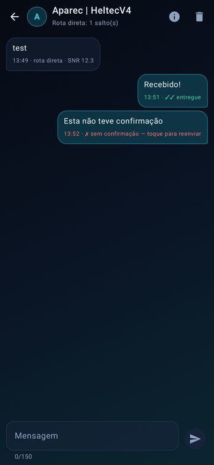
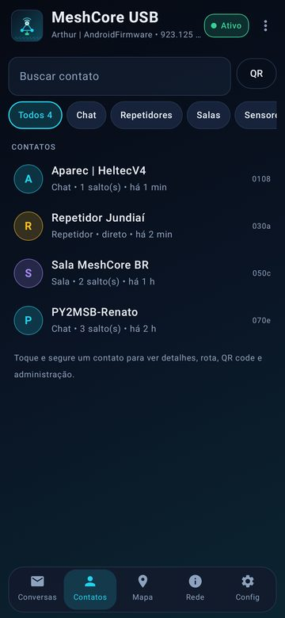
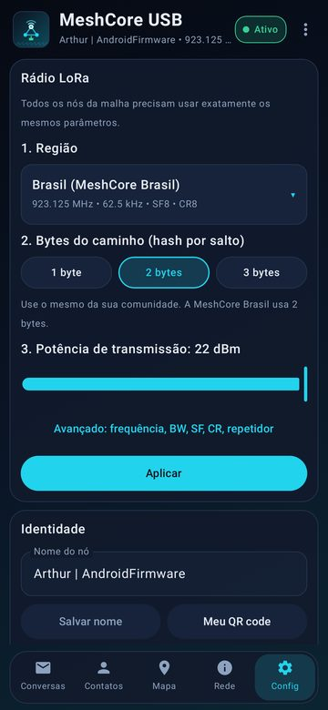

# MeshCore USB (AndroidMeshcore)

Rode um nó **[MeshCore](https://github.com/meshcore-dev/MeshCore) completo dentro do celular Android**.
Você pluga um **USB MeshStick** (CH341 + SX1262) no celular com um cabo **OTG** e já sai usando:
canais em grupo, mensagens diretas, contatos e configurações de rádio, tudo no mesmo app.
Não precisa gravar firmware, nem de Bluetooth, nem de um segundo app.

<p align="center">
  <br>
  <sub>Funcionando de verdade: celular Android + USB MeshStick (CH341 + SX1262) num adaptador OTG, recebendo a malha MeshCore Brasil.</sub>
</p>

> [!WARNING]
> Use por sua conta e risco. Você é responsável por transmitir só em frequências e potências
> permitidas onde você está.

Este projeto é o port para Android do [MeshCoreRPI](https://github.com/engperini/MeshCoreRPI). Ele usa o mesmo
firmware companion do MeshCore (`MyMesh`) e o mesmo driver SX1262 + CH341, compilados com o NDK. O app
fala com eles pelo protocolo companion oficial.

## Como funciona

```
┌──────────── celular Android ─────────────┐
│  UI (Compose): conversas, contatos, mapa, rede, config
│        │ frames do protocolo companion
│  libmeshcore.so (NDK)                    │
│    MyMesh (firmware companion MeshCore)  │
│    SX1262 driver ── Ch341Bridge (usbdevfs)│
└──────────────────┬───────────────────────┘
                   │ USB OTG
            USB MeshStick (CH341A 1a86:5512 + SX1262)
```

- O nó MeshCore roda **no celular**. O MeshStick é só o rádio, controlado via USB (SPI/GPIO do CH341).
- A identidade, os contatos e os canais ficam salvos no app. O histórico de mensagens fica em SQLite no celular.
- Um serviço em primeiro plano mantém o rádio ativo com a tela apagada.

## Telas

<p align="center">
  
  
  
</p>
<p align="center">
  
  
  
</p>

Mesmo visual do [MeshSDR-Android](https://github.com/engperini/MeshSDR-Android): tema escuro "céu noturno", cards
translúcidos e destaques em ciano. As telas acima são renderizadas pelos testes (`ScreenshotTest`) com dados de exemplo.

## Funcionalidades

- 💬 **Conversas**: canais em grupo e mensagens diretas numa lista só, com não lidas e a última mensagem.
  - **Canais**: o *Public* já vem configurado. Você pode criar **#hashtag** (todos que usam o mesmo `#nome` entram
    na mesma conversa), canal **privado novo** (chave aleatória) ou entrar num canal **com chave**. Para compartilhar,
    toque e segure o canal → **QR code**.
  - **Mensagens diretas**: status *enviando → enviado → entregue ✓✓* pela confirmação (ACK) do destinatário, com o
    tempo de ida e volta. Toque numa mensagem sem confirmação para reenviar.
  - **Salas (room servers)**: login pelo próprio chat. As mensagens aparecem com o nome do autor.
- 👥 **Contatos**: busca, filtro (chat, repetidor, sala, sensor), ordenação (recentes, nome, saltos) e "visto há".
  O detalhe do contato mostra a rota (repetidores do caminho) e tem os botões **Descobrir rota** (ida e volta),
  **Usar esta rota**, **Redefinir**, **QR code**, compartilhar zero-hop e remover. No modo "adicionar manualmente",
  os nós ouvidos ficam em **Descobertos** com o botão Adicionar.
- 🛠️ **Administração remota** de repetidores, salas e sensores:
  - **login** de admin ou convidado (dá para lembrar a senha);
  - **status**: bateria, uptime, fila, pacotes, flood/direto, tempo no ar, RSSI/SNR e ruído;
  - **terminal CLI** criptografado, com atalhos (`ver`, `clock`, `neighbors`, `get radio`…).
- 🔳 **QR codes `meshcore://`**, compatíveis com o app oficial: mostre o seu, o de um contato ou o de um canal.
  Escaneie com a câmera, ou abra um link `meshcore://` vindo de outro app.
- 🗺️ **Mapa** dos contatos com GPS, em OpenStreetMap sem chave de API (como o mapa web do MeshCoreRPI), em modo
  noturno.
- 📊 **Rede**, como o painel web do Pi:
  - estatísticas do nó: recebidos/enviados, flood/direto, SNR, RSSI, ruído, uptime, tempo no ar, erros;
  - gráfico de SNR/RSSI e contagem por tipo de pacote;
  - **diagnóstico do rádio** (`radio-diag`) e log de pacotes recebidos.
- ⚙️ **Configurações**:
  - **Rádio em 3 passos**: escolha a **região** (Brasil, EUA/Canadá, EU/UK, Austrália, Nova Zelândia), depois os
    **bytes do caminho** (1/2/3; a MeshCore Brasil usa 2) e a **potência**. Frequência, BW, SF, CR e o modo
    repetidor ficam em *Avançado*.
  - **Advert** manual (flood ou zero-hop) e automático (1 h, 3 h, 12 h).
  - **Contatos**: adicionar automaticamente ou manualmente, por tipo, e substituir o mais antigo quando a lista
    encher.
  - **Telemetria**: com quem compartilhar a bateria (ninguém, favoritos, todos).
  - **Localização** no advert (digitada ou pelo GPS).
  - **Backup da identidade**: exportar e restaurar a chave privada.
- 🔔 Notificações de mensagens novas, rádio ativo com a tela apagada, e o app abre sozinho quando você pluga o
  MeshStick.

## Comparação com o app oficial do MeshCore e com o MeshCoreRPI

| Funcionalidade | App oficial MeshCore | MeshCoreRPI (Pi) | MeshCore USB (este app) |
|---|---|---|---|
| Como conecta ao rádio | BLE/USB com um nó que roda firmware | SPI/USB no Pi; clientes por TCP | **USB OTG direto no MeshStick, nó roda no celular** |
| Canais Public, #hashtag e privados | ✅ | via cliente | ✅ |
| Mensagens diretas com ACK e reenvio | ✅ | via cliente | ✅ |
| Salas (room servers) | ✅ | via cliente | ✅ login + autores |
| Admin de repetidor (login, status, CLI) | ✅ | ✅ (web/CLI local) | ✅ |
| Descobrir/definir rota | ✅ | — | ✅ |
| QR codes `meshcore://` | ✅ | — | ✅ mostrar, escanear, abrir links |
| Mapa de contatos | ✅ | ✅ (mapa web) | ✅ OpenStreetMap |
| Presets de rádio por região | ✅ | README | ✅ região → bytes → potência |
| Tamanho do hash de caminho | ✅ | ✅ | ✅ |
| Advert automático | horário | ✅ (minutos) | ✅ |
| Estatísticas, gráficos, log de pacotes | parcial | ✅ (painel web) | ✅ aba Rede |
| Diagnóstico do rádio (`radio-diag`) | — | ✅ | ✅ |
| Backup da identidade (chave privada) | ✅ | — | ✅ |
| Telemetria de sensores, trace path | ✅ | — | ainda não |

## Hardware

| Rádio | Conexão | Status |
|---|---|---|
| USB MeshStick (CH341A `1a86:5512` + SX1262), por exemplo o Elecrow MeshStick | USB OTG | ✅ suportado |

Pinos, TCXO (DIO3) e chave de RF (DIO2) já vêm configurados para o MeshStick (CH341 D0/D2/D4/D6), como no
MeshCoreRPI.

Você precisa de:

- Celular Android 8.0 ou mais novo com **USB Host/OTG** (quase todos os atuais).
- Adaptador ou cabo **OTG** (USB-C → USB-A fêmea, por exemplo).
- **Antena** conectada ao MeshStick **antes** de ligar.

## Instalação

1. Baixe o `MeshCoreUSB.apk`, pela aba **Releases** ou pelo artefato da última execução em **Actions**.
2. Instale o APK. O Android vai pedir para permitir instalação de fontes desconhecidas.
3. Coloque a antena, conecte o MeshStick ao celular pelo OTG e aceite **abrir o MeshCore USB** e
   **permitir o acesso ao dispositivo USB**. Marque "usar sempre" para não perguntar de novo.
4. Na aba **Config** → **Rádio LoRa**, escolha a **região** (padrão: Brasil 923.125 MHz, 62.5 kHz, SF8, CR8), os
   **bytes do caminho** (Brasil: 2) e toque em **Aplicar**. Em **Identidade**, dê um nome ao seu nó.
5. Menu ⋮ → **Enviar advert (flood)** para ser descoberto. Depois é só abrir o canal *Public* e dar um oi 👋

Para atualizar, instale o APK novo por cima: a identidade, os contatos e as mensagens são mantidos, desde que os
dois APKs tenham a mesma assinatura. Antes de trocar de celular ou reinstalar, faça **Config → Backup da
identidade → Exportar**.

> [!TIP]
> Alguns celulares desligam o OTG depois de um tempo sem uso, ou economizam bateria de forma agressiva. Se o
> rádio parar com a tela apagada, desative a otimização de bateria para o MeshCore USB.

## Compilar

Requisitos: JDK 17, Android SDK (platform 35), NDK `27.2.12479018` e CMake `3.22.1`.

```bash
./gradlew assembleDebug        # app/build/outputs/apk/debug/app-debug.apk
./gradlew assembleRelease      # APK com R8
```

Assinatura: se existir `app/meshcore-debug.jks` (ou as variáveis `MESHCORE_KEYSTORE_FILE`,
`MESHCORE_KEYSTORE_PASSWORD`, `MESHCORE_KEY_ALIAS` e `MESHCORE_KEY_PASSWORD`), os APKs saem sempre com a mesma
assinatura. Sem ela, a chave de debug da máquina é usada. A chave fica fora do git.

### Testes (firmware real, dois nós)

`tools/hosttest` compila um **nó de teste para PC** a partir das mesmas fontes do `libmeshcore.so`, com um
"rádio" UDP no localhost. O teste `TwoNodeMeshTest` sobe dois nós e usa o codificador/decodificador de
protocolo do app (`Protocol.kt`) para exercitar:

- advert e lista de contatos;
- DM com ACK;
- canal Public e canal #hashtag;
- parâmetros de rádio, localização, remoção de contato;
- adição manual de contato descoberto;
- links `meshcore://`, rota salva, estatísticas, regras de auto-adicionar, backup da chave e descoberta de rota.

`ScreenshotTest` (Robolectric) renderiza as telas principais em `app/build/screenshots/`.

```bash
tools/hosttest/build.sh
./gradlew testDebugUnitTest
```

O workflow `.github/workflows/android.yml` roda os testes e gera o APK a cada push. Em tags `v*`, ele anexa o
APK à release.

## Estrutura

| Caminho | O que é |
|---|---|
| `app/src/main/cpp/meshcore/` | Núcleo MeshCore (`src/`), firmware companion (`companion_radio/`), ed25519 e Crypto (rweather), copiados do MeshCoreRPI |
| `app/src/main/cpp/android/` | Camada Android: `Ch341Bridge` via usbdevfs, driver SX1262, target (bateria/relógio), `AndroidSerialInterface`, JNI |
| `app/src/main/java/.../core/` | `Protocol.kt` (frames companion), `MeshController.kt` (estado, fila de comandos, mensagens), `NativeMesh.kt` (JNI) |
| `app/src/main/java/.../service/` | Serviço em primeiro plano + USB (permissão, fd, wake lock, notificações) |
| `app/src/main/java/.../ui/` | Telas Compose |
| `tools/hosttest/` | Nó de teste para PC (mesmo firmware, rádio UDP) |

Limites de compilação (como no MeshCoreRPI): `MAX_CONTACTS=500`, `MAX_GROUP_CHANNELS=20`. Ficam em
`app/src/main/cpp/CMakeLists.txt`.

## Créditos e licença

- [MeshCore](https://github.com/meshcore-dev/MeshCore), de Scott Powell / rippleradios.com: MIT.
- [MeshCoreRPI](https://github.com/engperini/MeshCoreRPI): port nativo para Linux, driver SX1262 e CH341.
- [Arduino Crypto](https://github.com/rweather/arduinolibs), de Rhys Weatherley: MIT.
- ed25519, de Orson Peters: zlib.

Licença MIT, veja [LICENSE](LICENSE).
