# MeshCommunity

**English** · [Português](#português)

[](https://github.com/engperini/AndroidMeshcore/releases/latest)


**One USB LoRa radio + your Android phone = a MeshCore node, a Meshtastic node or a raw LoRa terminal.
Switch networks with one tap. No firmware flashing, no Bluetooth, no second app.**

<p align="center">
  
  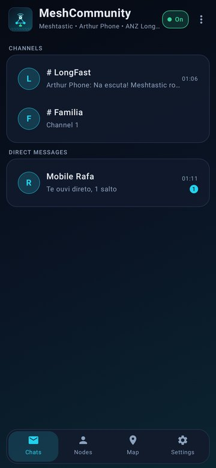
  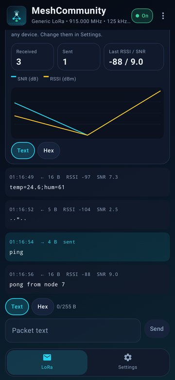
  <br><sub>The same radio running <b>MeshCore</b>, <b>Meshtastic</b> and <b>generic LoRa</b>, one at a time.</sub>
</p>

> [!WARNING]
> Use at your own risk. You are responsible for transmitting only on frequencies and power levels that are legal
> where you are.

## Contents

- [What makes it different: the firmware runs on the phone](#what-makes-it-different-the-firmware-runs-on-the-phone)
- [Supported hardware](#supported-hardware)
- [Quick start](#quick-start)
- [Screens](#screens)
- [Features](#features)
- [Future: the radio without the cable](#future-the-radio-without-the-cable)
- [How it works inside](#how-it-works-inside)
- [Build](#build) · [Tests](#tests) · [Layout](#layout) · [Credits and license](#credits-and-license)

## What makes it different: the firmware runs on the phone

On a normal mesh radio, a microcontroller board runs the firmware and the phone is only a screen, connected over
Bluetooth. The network is decided by the firmware you flash: to go from MeshCore to Meshtastic you take a computer,
flash the board again, and switch to another app.

MeshCommunity turns that around. **The firmware runs inside the app, on the phone.** The USB radio is only a radio
(an SX1262 LoRa chip plus a tiny USB-to-SPI bridge), so it never needs to know which network you use.

```
  The usual way                                    MeshCommunity
  ─────────────                                    ─────────────
  📱 app ──Bluetooth──▶ 📟 board with MCU          📱 app + firmware (MeshCore, Meshtastic, LoRa)
                         └ runs ONE firmware          │
                           (reflash to change)        └──USB OTG──▶ 📻 radio only (no firmware)
```

What this gives you:

| | Usual mesh radio | MeshCommunity |
|---|---|---|
| Change network (MeshCore ↔ Meshtastic) | flash another firmware with a computer | **tap Settings → Mode** |
| Update the firmware | flash the board | **update the app** (APK) |
| Apps | one app per network | **one app** for all |
| Your data when you switch | lost when you reflash | **each mode keeps its own** identity, contacts, channels and messages |
| Radio hardware | board with a microcontroller | a **USB radio with no microcontroller** is enough |
| Link phone ↔ radio | Bluetooth (pairing, range) | **USB cable** (OTG) |
| Clock, GPS, battery | board's own | the **phone's** |

What to keep in mind:

- **One network at a time.** Switching takes a second, but the radio listens to one protocol at a time.
- **The node lives in the phone.** If you unplug the radio or the app is stopped, the node is offline: this is a
  companion for you to carry, not a standalone repeater on a rooftop.
- The radio draws its power from the phone (a few tens of mA receiving).

## Supported hardware

| Radio | What it is | Status |
|---|---|---|
| **USB MeshStick** (e.g. Elecrow MeshStick) | CH341A USB bridge (`1a86:5512`) + SX1262. Plug and play. | ✅ supported, field-tested |
| **Seeed XIAO nRF52840 + Wio-SX1262 kit** | The XIAO only works as a USB-to-SPI bridge, like the MeshStick's CH341: flash the [xiao-sx1262-usb-bridge](https://github.com/engperini/xiao-sx1262-usb-bridge) firmware **once** and never again. | ✅ supported, field-tested |
| **USB LoRa stick, no MCU** (CH341F + Wio-SX1262) | Our own 20.5 × 14 mm board, in [`hardware/`](hardware/), with JLCPCB order files and a 3D-printed case. | 🧪 v0.2 design, not built yet |

All of them run all three modes: the app drives every radio through the same USB driver. The XIAO kit is the
practical choice if you already have one; the MeshStick needs nothing at all.

<p align="center">
  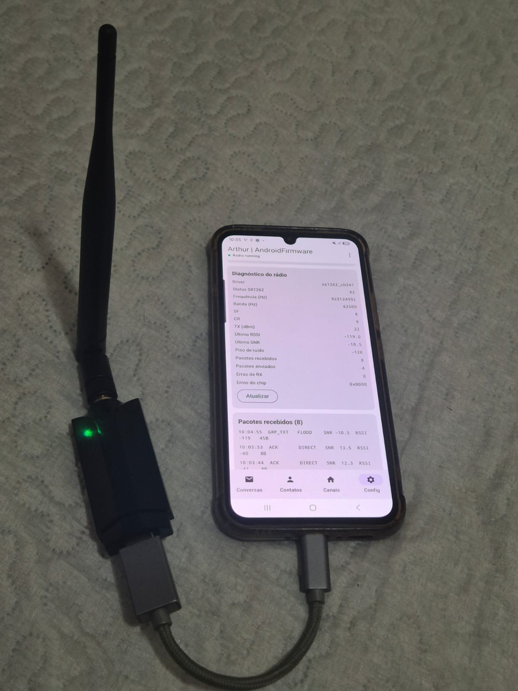<br>
  <sub>An Android phone + a USB MeshStick on an OTG adapter, receiving the MeshCore Brasil mesh.</sub>
</p>

You also need:

- An Android **8.0+** phone with **USB host/OTG** (almost every current phone).
- An **OTG** adapter or cable (e.g. USB-C → USB-A female).
- An **antenna** on the radio **before** you plug it in.

## Quick start

1. Download **`MeshCommunity.apk`** from [Releases](https://github.com/engperini/AndroidMeshcore/releases/latest) and
   install it (Android asks you to allow installs from unknown sources).
2. Attach the antenna, plug the radio into the phone with OTG, and allow **MeshCommunity to open** and to **access
   the USB device** (tick "always"). The app opens by itself next time you plug it in.
3. Choose the network in **Settings → Mode**, then:

**MeshCore**
- Settings → **LoRa radio**: pick your **region** (Brazil is preset: 923.125 MHz, 62.5 kHz, SF8, CR8), the **path
  bytes** (MeshCore Brasil: 2) and tap **Apply**. Under **Identity**, name your node.
- Menu ⋮ → **Send advert (flood)** so others find you, then say hi in the *Public* channel 👋

**Meshtastic**
- Settings → **Meshtastic radio**: choose the **region** (Meshtastic does not transmit until it is set; in Brazil
  most communities use **ANZ**, LongFast at 919.875 MHz) and keep the **LongFast** preset to talk to the default mesh.
- Under **Meshtastic node**, set your long and short name. Menu ⋮ → **Announce node** so others see you now.
- Chat in **#LongFast**, see who is around in **Nodes**, run a **Traceroute**, and find nodes on the **Map**.

**Generic LoRa**
- Settings → **Generic LoRa radio**: pick a preset or set frequency, bandwidth, SF, CR, sync word and power.
- The **LoRa** tab shows every packet heard on those parameters (text or hex, with RSSI/SNR) and sends your own:
  handy for your own sensors and telemetry.

To update, install the new APK over the old one: every mode keeps its data. Before changing phones, export your
MeshCore key in **Settings → Identity backup**.

> [!TIP]
> Some phones switch OTG off after a while or save battery aggressively. If the radio stops with the screen off,
> turn off battery optimisation for MeshCommunity.

## Screens

The screens are rendered by the app's tests (`ScreenshotTest`) with sample data, in English and Portuguese.

**MeshCore**

<p align="center">
  
  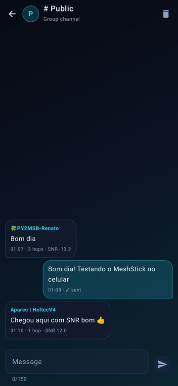
  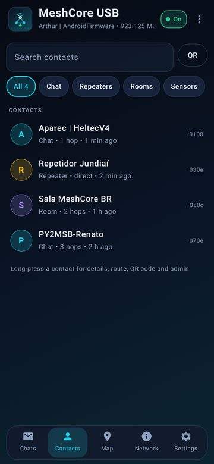
  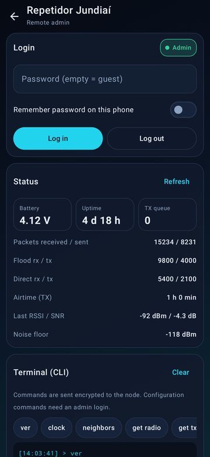
</p>
<p align="center">
  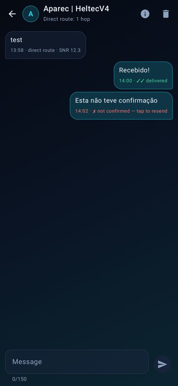
  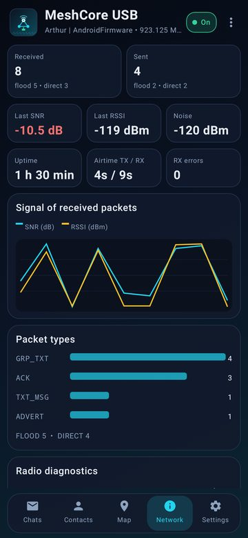
  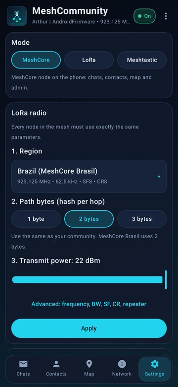
</p>

**Meshtastic**

<p align="center">
  
  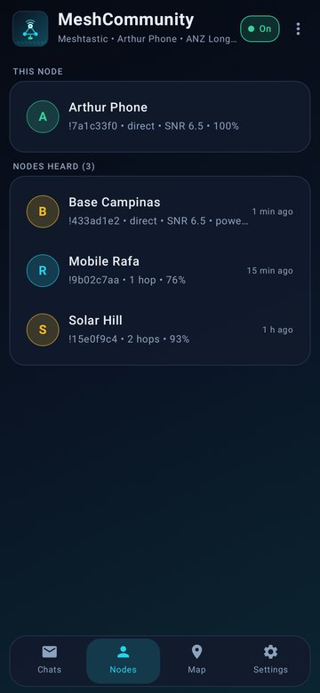
  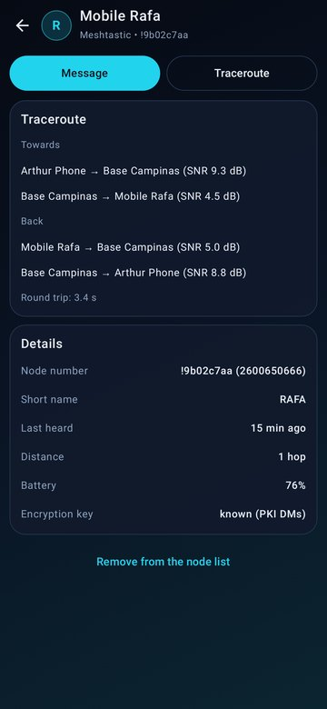
  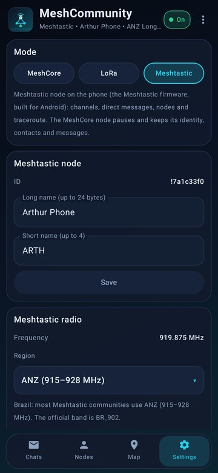
</p>

**Generic LoRa**

<p align="center">
  
  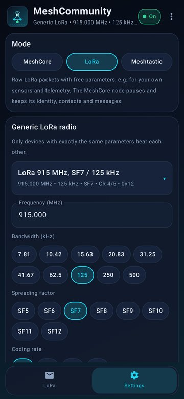
</p>

## Features

The app is in **English and Portuguese** (it follows the phone; switch in **Settings → Language**). In every mode
the radio keeps running with the screen off, new messages raise a notification, and the app opens when you plug the
radio in.

### MeshCore mode

The [MeshCore](https://github.com/meshcore-dev/MeshCore) companion firmware (`MyMesh`), the same as on a MeshCore
radio, talking to the app with the official companion protocol.

- 💬 **Chats**: group channels and direct messages in one list, with unread counts.
  - **Channels**: *Public* comes preconfigured. Create a **#hashtag** channel (everyone using the same `#name` joins
    the same chat), a **new private** channel (random key) or join one **with a key**. Long-press → **QR code** to
    share. Your channel messages show **how many repeaters were heard repeating them** (tap to see which).
  - **Direct messages**: *sending → sent → delivered ✓✓* with the round-trip time; tap an unconfirmed one to resend.
  - **Rooms (room servers)**: log in from the chat; posts show their author.
- 👥 **Contacts**: search, filters, sorting and "last seen". Each contact shows its route, with **Discover route**,
  **Ping** for repeaters (SNR at each hop), **Use this route**, **Reset**, **QR code** and zero-hop share.
- 🛠️ **Remote admin** of repeaters, rooms and sensors: login, **status** (battery, uptime, queue, packets, airtime,
  RSSI/SNR, noise) and an encrypted **CLI terminal**. Every request shows *waiting → answered in N s* or *no answer*.
- 🔳 **`meshcore://` QR codes** and links, compatible with the official app.
- 🗺️ **Map** of contacts with GPS (OpenStreetMap, no API key).
- 📊 **Network**: node stats, SNR/RSSI chart, packets by type, **radio diagnostics** and the packet log.
- ⚙️ **Settings**: radio in 3 steps (**region → path bytes → power**, with an *Advanced* section), manual and
  automatic **adverts**, contact rules, telemetry sharing, location, and **identity backup** (export/restore the key).

### Meshtastic mode

The [Meshtastic firmware](https://github.com/meshtastic/firmware) itself (2.8), built for Android. It talks on the
air with any Meshtastic device: T-Beams, Heltecs, RAKs, other phones…

- 💬 **Chats**: the node's channels (the primary shows its preset name, e.g. *LongFast*) and direct messages. Your
  messages show when a node was heard passing them on (implicit ACK); direct ones turn *delivered ✓✓*.
- 📡 **Nodes**: every node heard, with hops, SNR, battery and last heard. **Traceroute** shows the path out and back
  with the SNR of each hop. Menu ⋮ → **Announce node** sends your NodeInfo now.
- 🗺️ **Map**: nodes that share a position. **Share my position** sends the phone's GPS as your node's position.
- ⚙️ **Settings**: long and short name, **region**, modem preset, hop limit, power, and **channels** (name and key,
  add or delete).
- The node uses the phone's clock and GPS, and runs in its own Android process.

### Generic LoRa mode

Raw LoRa packets with free parameters: frequency, bandwidth 7.8–500 kHz, SF5–12, CR 4/5–4/8, sync word, preamble and
power. Every packet heard shows up as **text or hex** with **RSSI/SNR** and a signal chart, and you can send your
own. Presets listen to the MeshCore and Meshtastic channels. Good for your own sensors, telemetry and experiments.

### MeshCore mode compared

| Feature | Official MeshCore app | MeshCoreRPI (Pi) | MeshCommunity |
|---|---|---|---|
| How it reaches the radio | BLE/USB to a node running firmware | SPI/USB on the Pi; clients over TCP | **USB OTG to the radio, the node runs on the phone** |
| Public, #hashtag and private channels | ✅ | via a client | ✅ |
| Direct messages with ACK and resend | ✅ | via a client | ✅ |
| Rooms (room servers) | ✅ | via a client | ✅ |
| Repeater admin (login, status, CLI) | ✅ | ✅ | ✅ |
| Discover / set route, ping with SNR per hop | ✅ | — | ✅ |
| `meshcore://` QR codes | ✅ | — | ✅ |
| Map | ✅ | ✅ (web) | ✅ |
| Stats, charts, packet log, radio diagnostics | partial | ✅ (web) | ✅ |
| Identity backup | ✅ | — | ✅ |
| Also runs Meshtastic and generic LoRa | — | — | ✅ |
| Sensor telemetry | ✅ | — | not yet |

## Future: the radio without the cable

Today the radio is plugged into the phone. These are the next ideas, keeping what makes MeshCommunity different:
**the protocols run in the app, and the radio never needs to be flashed to change networks.**

**1. A LoRa modem over Bluetooth or Wi-Fi.** Over USB the phone drives the radio chip command by command, which
needs the ~0.3 ms round trips of a cable. Without a cable the radio needs a small microcontroller that speaks in
whole packets: *"set 919.875 MHz, SF11"*, *"send these 40 bytes"*, *"received 52 bytes, RSSI −97"*. That is one
message per packet, fine over Bluetooth or Wi-Fi.

A modem is not the same as the official firmware, even on the same board:

| | Official firmware | LoRa modem |
|---|---|---|
| Knows | the whole protocol: routing, encryption, channels, nodes | only the radio: bytes in, bytes out |
| Networks | one, the one flashed | any; it doesn't know which |
| Change network or update the protocol | flash the board | tap in the app / update the app |
| Without the phone | keeps relaying and storing messages | does nothing |

So for one network and a wireless radio, the official firmware on a Bluetooth board is the simpler choice; the
modem is for using several networks, raw LoRa, or new protocols with one radio. The idea is proven: ham radio's KISS
TNCs (APRSdroid over Bluetooth) and Reticulum's [RNode](https://github.com/markqvist/RNode_Firmware) are LoRa
modems of this kind. Speaking the RNode protocol, if it fits, would let boards already flashed with RNode work here.

**2. The Raspberry Pi as the home radio.** Many of us already keep a Pi with an SX1262 and the antenna at the window,
running a MeshCore repeater (e.g. with [MeshCoreRPI](https://github.com/engperini/MeshCoreRPI)). The Pi would run a
small radio server, and the app would connect to it over the home Wi-Fi: from the sofa, switch the window antenna to
Meshtastic to see the community chat, use the generic LoRa terminal, or back to MeshCore. When the phone lets go,
the Pi goes back to being the repeater. (One radio listens on one frequency at a time: while you use Meshtastic,
the MeshCore repeater pauses.)

**3. MeshCore repeater and companion on the same radio.** The MeshCore companion firmware only lets a companion
repeat on 433.000, 869.000 and 918.000 MHz, so not on the Brazilian 923.125 MHz. That is a deliberate network rule.
Instead of bypassing it, the same radio can carry two nodes side by side: a real **repeater**, with its own identity
and announced as a repeater, and **your companion**. The Pi at the window, or the USB radio on the phone, serves
both.

## How it works inside

```
┌─────────────────────────── Android phone ───────────────────────────┐
│  MeshCommunity UI (Compose): chats, contacts/nodes, map, settings     │
│        │                                   │                          │
│  libmeshcore.so (NDK)                  :meshtastic process            │
│   ├ MeshCore companion firmware        libmeshtastic.so (NDK)         │
│   └ generic LoRa mode                   └ Meshtastic firmware 2.8      │
│        │                                   │                          │
│        └──────── USB radio driver (usbdevfs, no root) ────────┘        │
└──────────────────────────────────┬──────────────────────────────────┘
                                   │ USB OTG
        MeshStick (CH341 + SX1262) · XIAO + Wio-SX1262 bridge · USB LoRa stick
```

- **MeshCore** runs in `libmeshcore.so`, ported from [MeshCoreRPI](https://github.com/engperini/MeshCoreRPI).
  The generic LoRa mode lives in the same library.
- **Meshtastic** runs in `libmeshtastic.so`: the firmware's portduino/WASM build compiled for Android, in its own
  process, so a node restart is simply a fresh process.
- Both drive the SX1262 through the same USB code, over Android's USB host API (no root).
- Each protocol keeps its own data in the app: identities, nodes, channels, and the message history in SQLite.

## Build

Requirements: JDK 17, Android SDK (platform 35), NDK `27.2.12479018` and CMake `3.22.1`.

```bash
./gradlew assembleDebug        # app/build/outputs/apk/debug/app-debug.apk
./gradlew assembleRelease      # R8-minified APK
```

Every build, local or CI, is signed with the public test key in `app/meshcore-debug.jks`, so new APKs install over
the previous one and keep your data. It is public on purpose: anyone can build and contribute. A fork can use its own
key with `MESHCORE_KEYSTORE_FILE`, `MESHCORE_KEYSTORE_PASSWORD`, `MESHCORE_KEY_ALIAS` and `MESHCORE_KEY_PASSWORD`.

## Tests

- `tools/hosttest` builds a **MeshCore PC node** from the same sources as `libmeshcore.so`, with a UDP "radio".
  `TwoNodeMeshTest` runs two of them and drives them with the app's protocol code: adverts, direct messages with
  ACK, channels, routes, links, key backup and more.
- `tools/meshtastic/hosttest` builds the **Meshtastic engine on the PC** with the same sources and glue as the app
  (simulated radio) and drives it like the app does: config, rename, text, traceroute, region, position.
- `ScreenshotTest` / `ScreenshotTestEn` (Robolectric) render the screens above.

```bash
tools/hosttest/build.sh
tools/meshtastic/hosttest/build.sh
./gradlew testDebugUnitTest
```

GitHub Actions runs all of them and builds the APK on every push; a manual run with a version publishes the release.

## Layout

| Path | What it is |
|---|---|
| `app/src/main/cpp/meshcore/` | MeshCore core and companion firmware, ed25519 and Crypto, from MeshCoreRPI |
| `app/src/main/cpp/android/` | USB radio buses (`Ch341Bridge`, `XiaoBridge`), SX1262 driver, JNI of `libmeshcore.so` |
| `app/src/main/cpp/meshtastic/` | Meshtastic engine: firmware and libraries in `vendor/` (fetched by `tools/meshtastic/vendor.sh` at fixed revisions), Android glue in `android/` |
| `app/src/main/java/.../core/` | Controllers: `MeshController` (MeshCore), `MeshtasticController`, `LoraController` (modes, generic LoRa) |
| `app/src/main/java/.../mt/` | Meshtastic engine process (`MtEngineService`) |
| `app/src/main/java/.../service/` | Foreground service and USB (permission, wake lock, notifications) |
| `app/src/main/java/.../ui/` | Compose screens |
| `hardware/` | No-MCU USB LoRa stick (KiCad, JLCPCB files) and 3D-printed cases |
| `tools/` | PC test nodes for MeshCore and Meshtastic |

## Credits and license

- [MeshCore](https://github.com/meshcore-dev/MeshCore) by Scott Powell / rippleradios.com: MIT.
- [MeshCoreRPI](https://github.com/engperini/MeshCoreRPI): native Linux port, SX1262 and CH341 driver.
- [Meshtastic firmware](https://github.com/meshtastic/firmware) by the Meshtastic developers: **GPL-3.0**, with
  [RadioLib](https://github.com/jgromes/RadioLib) (MIT), [portduino](https://github.com/meshtastic/framework-portduino)
  (GPL-3.0), [nanopb](https://github.com/nanopb/nanopb) (zlib) and the other libraries listed in
  [`app/src/main/cpp/meshtastic/vendor/LICENSES.md`](app/src/main/cpp/meshtastic/vendor/LICENSES.md).
- [Arduino Crypto](https://github.com/rweather/arduinolibs) by Rhys Weatherley: MIT. ed25519 by Orson Peters: zlib.

This repository's own code is under the MIT license, see [LICENSE](LICENSE). The Meshtastic engine is GPL-3.0, so
the **APK, which includes it, is distributed under GPL-3.0**; its complete source is this repository.

If MeshCommunity is useful to you, a ⭐ on GitHub helps other people find it.

---

# Português

[English](#meshcommunity) · **Português**

**Um rádio LoRa USB + seu celular Android = um nó MeshCore, um nó Meshtastic ou um terminal LoRa.
Troque de rede com um toque. Sem gravar firmware, sem Bluetooth, sem segundo app.**

<p align="center">
  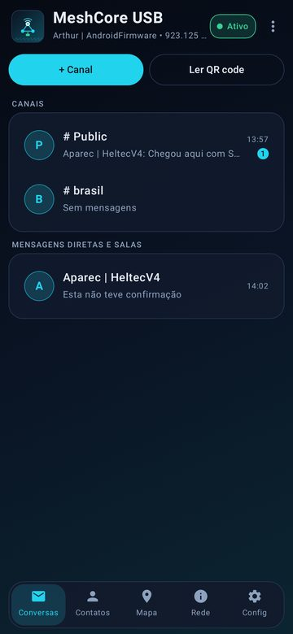
  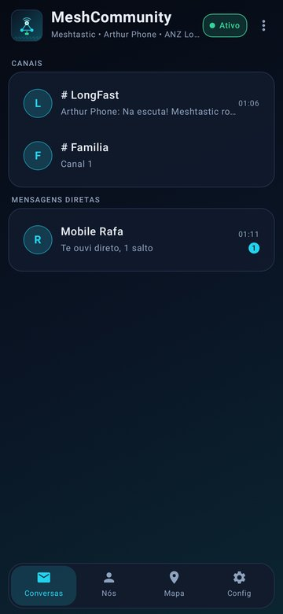
  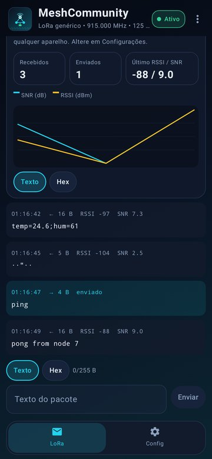
  <br><sub>O mesmo rádio rodando <b>MeshCore</b>, <b>Meshtastic</b> e <b>LoRa genérico</b>, um de cada vez.</sub>
</p>

> [!WARNING]
> Use por sua conta e risco. Você é responsável por transmitir só em frequências e potências permitidas onde você
> está.

## Índice

- [O diferencial: o firmware roda no celular](#o-diferencial-o-firmware-roda-no-celular)
- [Hardware compatível](#hardware-compatível)
- [Começo rápido](#começo-rápido)
- [Telas](#telas)
- [Funcionalidades](#funcionalidades)
- [Futuro: o rádio sem o cabo](#futuro-o-rádio-sem-o-cabo)
- [Como funciona por dentro](#como-funciona-por-dentro)
- [Compilar](#compilar) · [Testes](#testes) · [Estrutura](#estrutura) · [Créditos e licença](#créditos-e-licença)

## O diferencial: o firmware roda no celular

Num rádio mesh comum, uma placa com microcontrolador roda o firmware e o celular é só a tela, ligado por Bluetooth.
Quem decide a rede é o firmware gravado: para trocar de MeshCore para Meshtastic, você pega um computador, grava a
placa de novo e troca de app.

O MeshCommunity inverte isso. **O firmware roda dentro do app, no celular.** O rádio USB é só rádio (um chip LoRa
SX1262 e uma pequena ponte USB→SPI), então ele nem precisa saber qual rede você usa.

```
  O jeito comum                                    MeshCommunity
  ─────────────                                    ─────────────
  📱 app ──Bluetooth──▶ 📟 placa com MCU           📱 app + firmware (MeshCore, Meshtastic, LoRa)
                         └ roda UM firmware           │
                           (regravar para trocar)     └──USB OTG──▶ 📻 só o rádio (sem firmware)
```

O que você ganha:

| | Rádio mesh comum | MeshCommunity |
|---|---|---|
| Trocar de rede (MeshCore ↔ Meshtastic) | gravar outro firmware com um computador | **tocar em Config → Modo** |
| Atualizar o firmware | gravar a placa | **atualizar o app** (APK) |
| Apps | um app para cada rede | **um app** para todas |
| Seus dados ao trocar | perdidos ao regravar | **cada modo guarda os seus**: identidade, contatos, canais e mensagens |
| Hardware do rádio | placa com microcontrolador | basta um **rádio USB sem microcontrolador** |
| Ligação celular ↔ rádio | Bluetooth (pareamento, alcance) | **cabo USB** (OTG) |
| Relógio, GPS, bateria | os da placa | os do **celular** |

O que é bom saber:

- **Uma rede por vez.** A troca leva um segundo, mas o rádio escuta um protocolo de cada vez.
- **O nó mora no celular.** Se você desplugar o rádio ou o app for encerrado, o nó fica fora do ar: é um companheiro
  para levar com você, não um repetidor autônomo no telhado.
- O rádio é alimentado pelo celular (algumas dezenas de mA recebendo).

## Hardware compatível

| Rádio | O que é | Status |
|---|---|---|
| **USB MeshStick** (ex.: Elecrow MeshStick) | Ponte USB CH341A (`1a86:5512`) + SX1262. Plugar e usar. | ✅ suportado, testado em campo |
| **Kit Seeed XIAO nRF52840 + Wio-SX1262** | O XIAO só faz a ponte USB→SPI, como o CH341 do MeshStick: grave o firmware [xiao-sx1262-usb-bridge](https://github.com/engperini/xiao-sx1262-usb-bridge) **uma vez** e nunca mais. | ✅ suportado, testado em campo |
| **Pendrive LoRa sem MCU** (CH341F + Wio-SX1262) | Nossa placa de 20,5 × 14 mm, em [`hardware/`](hardware/), com os arquivos para pedir na JLCPCB e caixinha para impressora 3D. | 🧪 projeto v0.2, ainda não fabricado |

Todos rodam os três modos: o app usa o mesmo driver USB para qualquer rádio. O kit XIAO é a escolha prática para quem
já tem um; o MeshStick não precisa de nada.

<p align="center">
  <br>
  <sub>Celular Android + USB MeshStick num adaptador OTG, recebendo a malha MeshCore Brasil.</sub>
</p>

Você também precisa de:

- Celular Android **8.0** ou mais novo com **USB Host/OTG** (quase todos os atuais).
- Adaptador ou cabo **OTG** (USB-C → USB-A fêmea, por exemplo).
- **Antena** conectada ao rádio **antes** de plugar.

## Começo rápido

1. Baixe o **`MeshCommunity.apk`** em [Releases](https://github.com/engperini/AndroidMeshcore/releases/latest) e
   instale (o Android pede para permitir a instalação de fontes desconhecidas).
2. Coloque a antena, plugue o rádio no celular pelo OTG e aceite **abrir o MeshCommunity** e **permitir o acesso ao
   dispositivo USB** (marque "usar sempre"). Da próxima vez, o app abre sozinho quando você plugar.
3. Escolha a rede em **Config → Modo** e então:

**MeshCore**
- Config → **Rádio LoRa**: escolha a **região** (o Brasil já vem pronto: 923,125 MHz, 62,5 kHz, SF8, CR8), os
  **bytes do caminho** (MeshCore Brasil: 2) e toque em **Aplicar**. Em **Identidade**, dê um nome ao seu nó.
- Menu ⋮ → **Enviar advert (flood)** para ser encontrado e dê um oi no canal *Public* 👋

**Meshtastic**
- Config → **Rádio Meshtastic**: escolha a **região** (o Meshtastic não transmite até ela ser definida; no Brasil a
  maioria das comunidades usa **ANZ**, LongFast em 919,875 MHz) e mantenha o preset **LongFast** para falar com a malha
  padrão.
- Em **Nó Meshtastic**, defina o nome longo e o curto. Menu ⋮ → **Anunciar nó** para aparecer para os outros na hora.
- Converse no **#LongFast**, veja quem está por perto em **Nós**, faça um **Traceroute** e encontre os nós no **Mapa**.

**LoRa genérico**
- Config → **Rádio LoRa genérico**: escolha uma predefinição ou ajuste frequência, largura de banda, SF, CR, sync word
  e potência.
- A aba **LoRa** mostra cada pacote ouvido com esses parâmetros (texto ou hex, com RSSI/SNR) e envia os seus: útil
  para seus sensores e telemetria.

Para atualizar, instale o APK novo por cima: todos os modos mantêm seus dados. Antes de trocar de celular, exporte sua
chave do MeshCore em **Config → Backup da identidade**.

> [!TIP]
> Alguns celulares desligam o OTG depois de um tempo ou economizam bateria de forma agressiva. Se o rádio parar com a
> tela apagada, desative a otimização de bateria para o MeshCommunity.

## Telas

As telas são geradas pelos testes do app (`ScreenshotTest`) com dados de exemplo, em português e inglês.

**MeshCore**

<p align="center">
  
  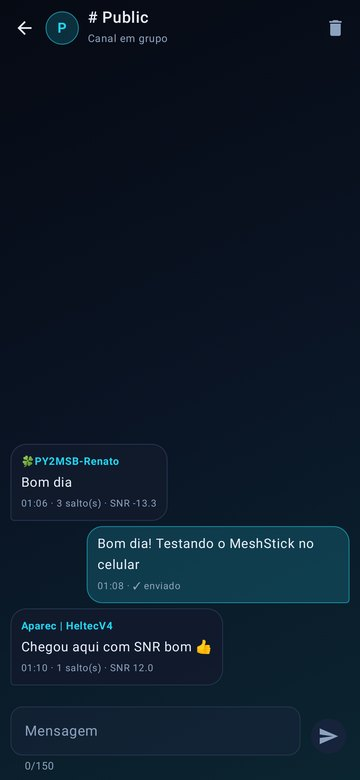
  
  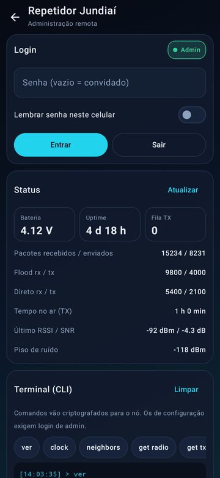
</p>
<p align="center">
  
  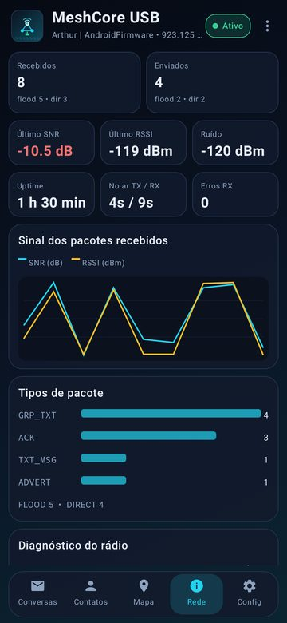
  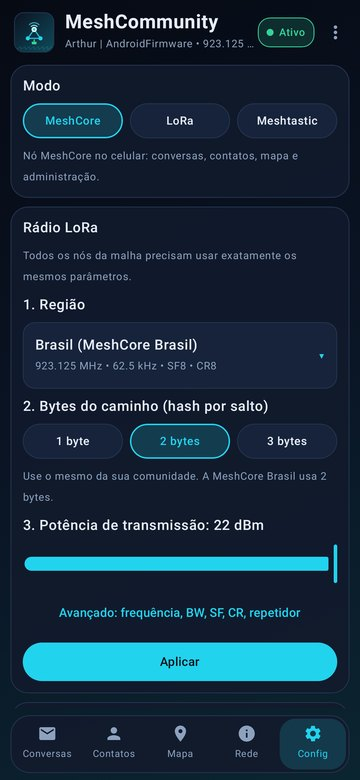
</p>

**Meshtastic**

<p align="center">
  
  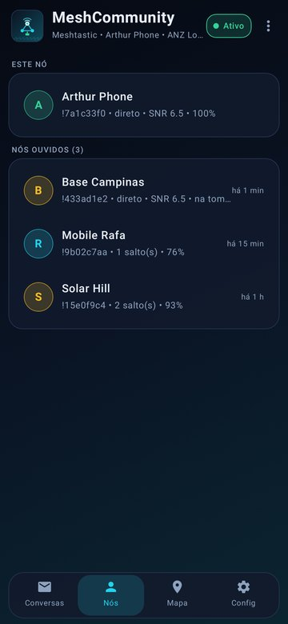
  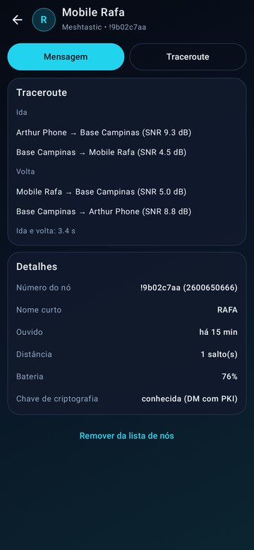
  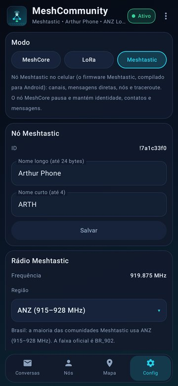
</p>

**LoRa genérico**

<p align="center">
  
  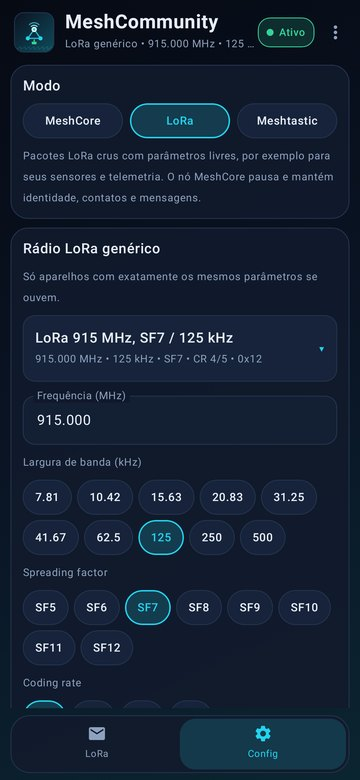
</p>

## Funcionalidades

O app está em **português e inglês** (segue o idioma do celular; troque em **Config → Idioma**). Em todos os modos o
rádio continua ativo com a tela apagada, mensagens novas geram notificação e o app abre quando você pluga o rádio.

### Modo MeshCore

O firmware companion do [MeshCore](https://github.com/meshcore-dev/MeshCore) (`MyMesh`), o mesmo de um rádio
MeshCore, conversando com o app pelo protocolo companion oficial.

- 💬 **Conversas**: canais em grupo e mensagens diretas numa lista só, com não lidas.
  - **Canais**: o *Public* já vem configurado. Crie um canal **#hashtag** (todos que usam o mesmo `#nome` entram na
    mesma conversa), um canal **privado novo** (chave aleatória) ou entre num canal **com chave**. Toque e segure →
    **QR code** para compartilhar. Suas mensagens no canal mostram **quantas repetidoras foram ouvidas repassando**
    (toque para ver quais).
  - **Mensagens diretas**: *enviando → enviado → entregue ✓✓* com o tempo de ida e volta; toque numa sem
    confirmação para reenviar.
  - **Salas (room servers)**: login pelo próprio chat; as mensagens mostram o autor.
- 👥 **Contatos**: busca, filtros, ordenação e "visto há". Cada contato mostra a rota, com **Descobrir rota**,
  **Ping** para repetidores (SNR em cada salto), **Usar esta rota**, **Redefinir**, **QR code** e compartilhar
  zero-hop.
- 🛠️ **Administração remota** de repetidores, salas e sensores: login, **status** (bateria, uptime, fila, pacotes,
  tempo no ar, RSSI/SNR, ruído) e **terminal CLI** criptografado. Cada pedido mostra *aguardando → respondeu em N s*
  ou *sem resposta*.
- 🔳 **QR codes e links `meshcore://`**, compatíveis com o app oficial.
- 🗺️ **Mapa** dos contatos com GPS (OpenStreetMap, sem chave de API).
- 📊 **Rede**: estatísticas do nó, gráfico de SNR/RSSI, pacotes por tipo, **diagnóstico do rádio** e log de pacotes.
- ⚙️ **Config**: rádio em 3 passos (**região → bytes do caminho → potência**, com seção *Avançado*), **advert**
  manual e automático, regras de contatos, compartilhamento de telemetria, localização e **backup da identidade**
  (exportar/restaurar a chave).

### Modo Meshtastic

O próprio [firmware Meshtastic](https://github.com/meshtastic/firmware) (2.8), compilado para Android. Ele conversa
no ar com qualquer aparelho Meshtastic: T-Beam, Heltec, RAK, outros celulares…

- 💬 **Conversas**: os canais do nó (o primário mostra o nome do preset, ex.: *LongFast*) e mensagens diretas. Suas
  mensagens mostram quando um nó foi ouvido repassando (ACK implícito); as diretas ficam *entregue ✓✓*.
- 📡 **Nós**: todos os nós ouvidos, com saltos, SNR, bateria e quando foi ouvido. O **Traceroute** mostra o caminho de
  ida e volta com o SNR de cada salto. Menu ⋮ → **Anunciar nó** envia seu NodeInfo na hora.
- 🗺️ **Mapa**: os nós que compartilham posição. **Compartilhar posição** envia o GPS do celular como a posição do
  seu nó.
- ⚙️ **Config**: nome longo e curto, **região**, preset do modem, limite de saltos, potência e **canais** (nome e
  chave, adicionar ou excluir).
- O nó usa o relógio e o GPS do celular e roda num processo Android próprio.

### Modo LoRa genérico

Pacotes LoRa crus com parâmetros livres: frequência, largura de banda de 7,8 a 500 kHz, SF5–12, CR 4/5–4/8, sync word,
preâmbulo e potência. Cada pacote ouvido aparece em **texto ou hex** com **RSSI/SNR** e gráfico de sinal, e você pode
enviar os seus. Há predefinições para ouvir os canais MeshCore e Meshtastic. Bom para seus sensores, telemetria e
experiências.

### Comparação do modo MeshCore

| Funcionalidade | App oficial MeshCore | MeshCoreRPI (Pi) | MeshCommunity |
|---|---|---|---|
| Como chega ao rádio | BLE/USB com um nó que roda firmware | SPI/USB no Pi; clientes por TCP | **USB OTG no rádio, o nó roda no celular** |
| Canais Public, #hashtag e privados | ✅ | via cliente | ✅ |
| Mensagens diretas com ACK e reenvio | ✅ | via cliente | ✅ |
| Salas (room servers) | ✅ | via cliente | ✅ |
| Admin de repetidor (login, status, CLI) | ✅ | ✅ | ✅ |
| Descobrir/definir rota, ping com SNR por salto | ✅ | — | ✅ |
| QR codes `meshcore://` | ✅ | — | ✅ |
| Mapa | ✅ | ✅ (web) | ✅ |
| Estatísticas, gráficos, log de pacotes, diagnóstico do rádio | parcial | ✅ (web) | ✅ |
| Backup da identidade | ✅ | — | ✅ |
| Também roda Meshtastic e LoRa genérico | — | — | ✅ |
| Telemetria de sensores | ✅ | — | ainda não |

## Futuro: o rádio sem o cabo

Hoje o rádio fica plugado no celular. Estas são as próximas ideias, mantendo o que faz o MeshCommunity diferente:
**os protocolos rodam no app, e o rádio nunca precisa ser regravado para trocar de rede.**

**1. Um modem LoRa por Bluetooth ou Wi-Fi.** Pela USB, o celular controla o chip do rádio comando por comando, o que
exige as idas e voltas de ~0,3 ms de um cabo. Sem cabo, o rádio precisa de um pequeno microcontrolador que fala em
pacotes inteiros: *"ajuste 919,875 MHz, SF11"*, *"transmita estes 40 bytes"*, *"recebi 52 bytes, RSSI −97"*. É uma
mensagem por pacote, o que funciona bem por Bluetooth ou Wi-Fi.

Um modem não é o mesmo que o firmware oficial, mesmo na mesma placa:

| | Firmware oficial | Modem LoRa |
|---|---|---|
| Sabe | o protocolo inteiro: roteamento, criptografia, canais, nós | só o rádio: bytes entram, bytes saem |
| Redes | uma, a que foi gravada | qualquer uma; ele nem sabe qual |
| Trocar de rede ou atualizar o protocolo | regravar a placa | um toque no app / atualizar o app |
| Sem o celular | continua repetindo e guardando mensagens | não faz nada |

Por isso, para uma rede só com rádio sem fio, o firmware oficial numa placa com Bluetooth é a escolha mais simples; o
modem é para usar várias redes, LoRa livre ou protocolos novos com um rádio só. A ideia é comprovada: os TNC KISS do
radioamador (o APRSdroid usa por Bluetooth) e o [RNode](https://github.com/markqvist/RNode_Firmware) da rede
Reticulum são modems LoRa desse tipo. Falar o protocolo do RNode, se ele servir, permitiria usar aqui placas que já
têm o firmware RNode.

**2. O Raspberry Pi como o rádio de casa.** Muita gente já deixa um Pi com SX1262 e a antena na janela, rodando um
repetidor MeshCore (por exemplo com o [MeshCoreRPI](https://github.com/engperini/MeshCoreRPI)). O Pi rodaria um pequeno
servidor de rádio, e o app se conectaria a ele pelo Wi-Fi de casa: do sofá, você troca a antena da janela para o
Meshtastic e vê a conversa da comunidade, usa o terminal LoRa genérico ou volta para o MeshCore. Quando o celular
solta, o Pi volta a ser o repetidor. (Um rádio escuta uma frequência por vez: enquanto você usa o Meshtastic, o
repetidor MeshCore pausa.)

**3. Repetidor e companion MeshCore no mesmo rádio.** O firmware companion do MeshCore só deixa um companion repetir
em 433,000, 869,000 e 918,000 MHz, ou seja, não nos 923,125 MHz do Brasil. É uma regra intencional da rede. Em vez de
furá-la, o mesmo rádio pode carregar dois nós lado a lado: um **repetidor de verdade**, com identidade própria e
anunciado como repetidor, e o **seu companion**. O Pi na janela, ou o rádio USB no celular, atende os dois.

## Como funciona por dentro

```
┌────────────────────────── celular Android ──────────────────────────┐
│  Interface do MeshCommunity (Compose): conversas, contatos/nós, mapa  │
│        │                                   │                          │
│  libmeshcore.so (NDK)                  processo :meshtastic           │
│   ├ firmware companion MeshCore        libmeshtastic.so (NDK)         │
│   └ modo LoRa genérico                  └ firmware Meshtastic 2.8      │
│        │                                   │                          │
│        └────── driver USB do rádio (usbdevfs, sem root) ──────┘        │
└──────────────────────────────────┬──────────────────────────────────┘
                                   │ USB OTG
        MeshStick (CH341 + SX1262) · ponte XIAO + Wio-SX1262 · pendrive LoRa
```

- O **MeshCore** roda na `libmeshcore.so`, portada do [MeshCoreRPI](https://github.com/engperini/MeshCoreRPI). O modo
  LoRa genérico fica na mesma biblioteca.
- O **Meshtastic** roda na `libmeshtastic.so`: a versão portduino/WASM do firmware compilada para Android, num
  processo próprio, então reiniciar o nó é só iniciar um processo novo.
- Os dois controlam o SX1262 pelo mesmo código USB, pela API de USB host do Android (sem root).
- Cada protocolo guarda seus dados no app: identidades, nós, canais e o histórico de mensagens em SQLite.

## Compilar

Requisitos: JDK 17, Android SDK (platform 35), NDK `27.2.12479018` e CMake `3.22.1`.

```bash
./gradlew assembleDebug        # app/build/outputs/apk/debug/app-debug.apk
./gradlew assembleRelease      # APK com R8
```

Todo build, local ou no CI, é assinado com a chave pública de teste em `app/meshcore-debug.jks`, então os APKs novos
instalam por cima e mantêm seus dados. Ela é pública de propósito, para qualquer pessoa compilar e contribuir. Um fork
pode usar a própria chave com `MESHCORE_KEYSTORE_FILE`, `MESHCORE_KEYSTORE_PASSWORD`, `MESHCORE_KEY_ALIAS` e
`MESHCORE_KEY_PASSWORD`.

## Testes

- `tools/hosttest` gera um **nó MeshCore para PC** com as mesmas fontes da `libmeshcore.so`, com um "rádio" UDP. O
  `TwoNodeMeshTest` roda dois deles e os controla com o código de protocolo do app: adverts, mensagens diretas com
  ACK, canais, rotas, links, backup da chave e mais.
- `tools/meshtastic/hosttest` gera o **motor Meshtastic no PC** com as mesmas fontes e cola do app (rádio simulado) e
  o controla como o app: configuração, nome, texto, traceroute, região e posição.
- `ScreenshotTest` / `ScreenshotTestEn` (Robolectric) geram as telas acima.

```bash
tools/hosttest/build.sh
tools/meshtastic/hosttest/build.sh
./gradlew testDebugUnitTest
```

O GitHub Actions roda todos eles e gera o APK a cada push; uma execução manual com a versão publica a release.

## Estrutura

| Caminho | O que é |
|---|---|
| `app/src/main/cpp/meshcore/` | Núcleo e firmware companion do MeshCore, ed25519 e Crypto, do MeshCoreRPI |
| `app/src/main/cpp/android/` | Barramentos USB do rádio (`Ch341Bridge`, `XiaoBridge`), driver SX1262, JNI da `libmeshcore.so` |
| `app/src/main/cpp/meshtastic/` | Motor Meshtastic: firmware e bibliotecas em `vendor/` (baixados por `tools/meshtastic/vendor.sh` em revisões fixas), cola Android em `android/` |
| `app/src/main/java/.../core/` | Controladores: `MeshController` (MeshCore), `MeshtasticController`, `LoraController` (modos, LoRa genérico) |
| `app/src/main/java/.../mt/` | Processo do motor Meshtastic (`MtEngineService`) |
| `app/src/main/java/.../service/` | Serviço em primeiro plano e USB (permissão, wake lock, notificações) |
| `app/src/main/java/.../ui/` | Telas Compose |
| `hardware/` | Pendrive LoRa USB sem MCU (KiCad, arquivos JLCPCB) e caixinhas para impressão 3D |
| `tools/` | Nós de teste para PC, MeshCore e Meshtastic |

## Créditos e licença

- [MeshCore](https://github.com/meshcore-dev/MeshCore), de Scott Powell / rippleradios.com: MIT.
- [MeshCoreRPI](https://github.com/engperini/MeshCoreRPI): port nativo para Linux, driver SX1262 e CH341.
- [Firmware Meshtastic](https://github.com/meshtastic/firmware), dos desenvolvedores do Meshtastic: **GPL-3.0**, com
  [RadioLib](https://github.com/jgromes/RadioLib) (MIT), [portduino](https://github.com/meshtastic/framework-portduino)
  (GPL-3.0), [nanopb](https://github.com/nanopb/nanopb) (zlib) e as outras bibliotecas listadas em
  [`app/src/main/cpp/meshtastic/vendor/LICENSES.md`](app/src/main/cpp/meshtastic/vendor/LICENSES.md).
- [Arduino Crypto](https://github.com/rweather/arduinolibs), de Rhys Weatherley: MIT. ed25519, de Orson Peters: zlib.

O código próprio deste repositório está sob a licença MIT, veja [LICENSE](LICENSE). O motor Meshtastic é GPL-3.0, por
isso o **APK, que o inclui, é distribuído sob a GPL-3.0**; o código-fonte completo é este repositório.

Se o MeshCommunity for útil para você, uma ⭐ no GitHub ajuda outras pessoas a encontrá-lo.
